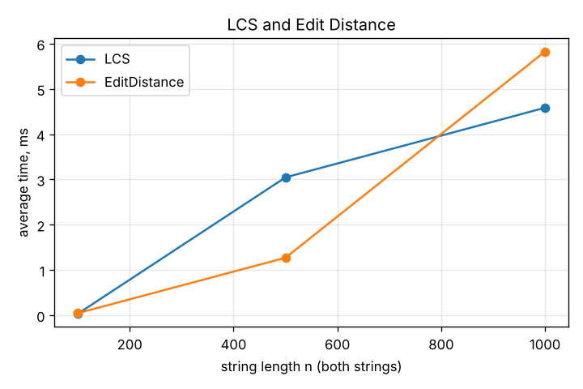
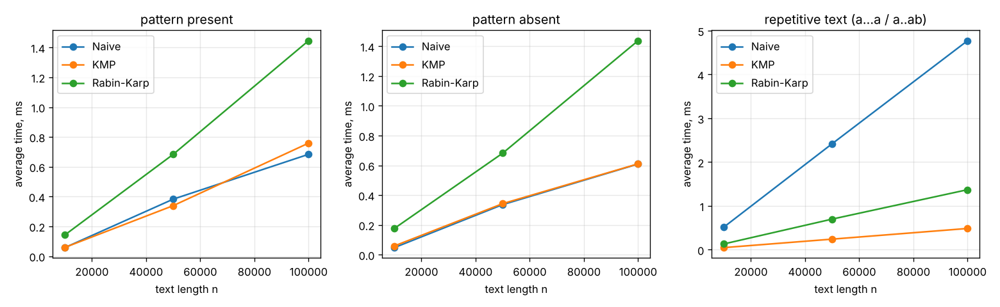
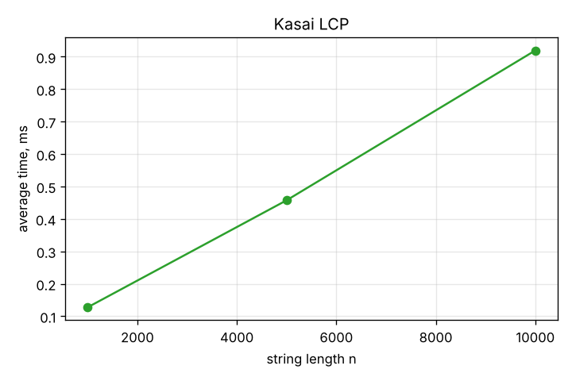

# Assignment 4: Text Analysis with DP and String Algorithms

Java implementation of LCS, Edit Distance, Naive / KMP / Rabin-Karp string matching and Kasai's LCP array, with tests and benchmarks.

## How to run

Needs JDK 17+ (tested on 21). Plots need Python 3 with matplotlib.

```bash
./run.sh
```

Or step by step:

```bash
javac -d out $(find src -name "*.java")
java -cp out textanalysis.TestRunner
java -Xms512m -cp out textanalysis.bench.Benchmark results
python3 scripts/plot.py results plots
```

## Project structure

```
src/main/java/textanalysis/
  dp/         Lcs, EditDistance
  matching/   Matcher, NaiveMatcher, KmpMatcher, RabinKarpMatcher
  suffix/     SuffixArray, Kasai
  bench/      InputGenerator, Timer, DpExperiment, MatchingExperiment, KasaiExperiment, Benchmark
src/test/java/textanalysis/   tests + small Check helper and TestRunner
scripts/plot.py               builds plots from results/*.csv
results/                      csv output of the benchmark
plots/                        png plots
```

## 1. Problems and algorithms

**LCS.** Length of the longest subsequence that appears in both strings (not necessarily contiguous).
`dp[i][j]` = LCS of `a[0..i)` and `b[0..j)`.

```
dp[i][0] = dp[0][j] = 0
dp[i][j] = dp[i-1][j-1] + 1               if a[i-1] == b[j-1]
dp[i][j] = max(dp[i-1][j], dp[i][j-1])    otherwise
```

Why it works: if the last characters are equal, some optimal LCS ends with that character, so we take it and solve the rest. If they differ, at least one of them is not in the LCS, so the answer is the better of dropping `a[i-1]` or dropping `b[j-1]`. Every cell only depends on smaller prefixes, so filling the table row by row is enough. `Lcs.sequence` also walks the table back to get the actual subsequence.

**Edit Distance (Levenshtein).** Minimum number of insertions, deletions and substitutions to turn `a` into `b`.
`dp[i][j]` = distance between `a[0..i)` and `b[0..j)`.

```
dp[i][0] = i,  dp[0][j] = j
dp[i][j] = min( dp[i-1][j-1] + (a[i-1] != b[j-1]),   substitute / keep
                dp[i-1][j] + 1,                      delete a[i-1]
                dp[i][j-1] + 1 )                     insert b[j-1]
```

Why it works: in an optimal sequence of edits the last position is handled in exactly one of these three ways, and what's left is a smaller instance of the same problem. Base cases: turning a prefix into an empty string takes `i` deletions, and the other way `j` insertions.

**Naive matching.** Try every shift `i` from `0` to `n-m` and compare the pattern char by char until a mismatch.

**KMP.** First builds the prefix table `lps[k]` = length of the longest proper prefix of `pattern[0..k]` that is also its suffix. During the search the text pointer `i` never moves back. On a mismatch after `j` matched chars we already know the last `j` text chars equal `pattern[0..j)`, so we jump to `j = lps[j-1]` instead of restarting. That is how KMP avoids comparing the same text characters again.

**Rabin-Karp.** Polynomial hash with base 256 and modulus 1 000 000 007. The window hash is updated in O(1) when sliding (remove the first char, multiply, add the new char). When the hash equals the pattern hash, the window is checked char by char, so a collision (same hash, different string) is just counted and skipped and never reported as a match. The test with modulus 7 forces many collisions and still gets the right answer.

**Kasai.** Given `s` and its suffix array `sa`, builds `lcp[i]` = length of the longest common prefix of suffixes `sa[i-1]` and `sa[i]` (`lcp[0] = 0`). It goes through suffixes in text order and uses the fact that if suffix `i` has LCP `h` with its neighbour, suffix `i+1` has LCP at least `h-1` with its own neighbour. So `h` only drops by one per step. The LCP array is useful for things like counting distinct substrings, longest repeated substring, etc.

## 2. Implementation decisions and assumptions

- All algorithms are written by hand, no `indexOf` / regex / library helpers.
- DP uses a full `(n+1) x (m+1)` table so the LCS can be reconstructed. Two rows would be enough for just the length.
- Matchers implement one `Matcher` interface and return a `List<Integer>` of all start positions (overlapping matches included).
- **Empty pattern returns an empty list.** I treat it as "nothing to search for". Pattern longer than text also returns an empty list.
- Comparisons are counted as character comparisons `text[x] vs pattern[y]`. For KMP the prefix table comparisons are included. For Rabin-Karp only the verification comparisons are counted, hash arithmetic is not.
- Suffix array is built with a simple comparison sort (`SuffixArray.build`), O(n² log n) worst case. It is only used to prepare input and is not timed.
- Strings are Java `String`s, characters are compared as `char`.

## 3. Complexity

n, m are the lengths of the two strings (or text and pattern).

| Algorithm | Main operation / recurrence | Best time | Worst time | Aux. space | Why |
|---|---|---|---|---|---|
| LCS | `dp[i][j]` from `dp[i-1][j-1]`, `dp[i-1][j]`, `dp[i][j-1]` | Θ(nm) | Θ(nm) | Θ(nm) | every cell is filled once in O(1), no early exit |
| Edit Distance | min of substitute / delete / insert | Θ(nm) | Θ(nm) | Θ(nm) | same table shape, O(1) per cell |
| Naive | compare pattern at every shift | O(n) | O(nm) | O(1) | best: first char mismatches at each shift; worst: almost full match each time (`aaa..a` / `aa..ab`) |
| KMP | prefix table + one pass over text | O(m) pre + O(n) | O(m) pre + O(n) | O(m) | `i` never goes back, each fallback `j = lps[j-1]` is paid by an earlier increment of `j`, so at most 2n comparisons |
| Rabin-Karp | rolling hash, verify on equal hash | O(m) pre + O(n + m) | O(nm) | O(1) | expected O(n+m) with a good modulus; worst case if every window collides or matches and needs O(m) verification |
| Kasai | `h` carried from suffix `i` to `i+1`, minus 1 | Θ(n) | Θ(n) | Θ(n) | `h` grows at most n times in total and drops by at most 1 per step, so total comparisons ≤ 2n; `rank` and `lcp` arrays are O(n) |

Rabin-Karp: the expected bound assumes hash values behave randomly, so a false match happens with probability about 1/q per window. The worst case is a bad modulus or a text with many real matches (e.g. `aaaa` and `aa`), where almost every window is verified.

These are theoretical bounds. Measured times below also depend on JIT, cache and memory allocation, so they don't map 1:1 to the formulas.

## 4. Testing

`TestRunner` runs everything with a tiny `Check` helper (no JUnit, so nothing to download). It exits with code 1 if something fails.

- LCS: identical strings, completely different, empty first / second / both, classic `ABCBDAB` / `BDCABA` = 4, reconstruction `GTAB`.
- Edit Distance: identical = 0, one empty, single substitution / insertion / deletion, `kitten -> sitting` = 3, `sunday -> saturday` = 3.
- Matching: beginning, middle, end, multiple (overlapping) occurrences, absent, pattern longer than text, empty pattern, empty text, pattern equal to text. Every case is checked against the expected list for **all three** matchers, so they must agree. Also the KMP prefix table for `ababaca` and Rabin-Karp with modulus 7 (forced collisions).
- Kasai: `banana` with manually checked SA `[5, 3, 1, 0, 4, 2]` and LCP `[0, 1, 3, 0, 0, 2]`, plus `mississippi`, a one-char string and `aaaa`.

Check for `banana`:

| i | sa[i] | suffix | lcp[i] |
|---|---|---|---|
| 0 | 5 | a | 0 |
| 1 | 3 | ana | 1 |
| 2 | 1 | anana | 3 |
| 3 | 0 | banana | 0 |
| 4 | 4 | na | 0 |
| 5 | 2 | nana | 2 |

Result:

```
passed: 58, failed: 0
```

The benchmark also checks that the three matchers return the same list on every workload and throws if not.

## 5. Experimental setup

- Alphabet: `{a, b, c, d}` for every random string. Seed `42` (`java.util.Random`).
- LCS / Edit Distance: two random strings of length 100, 500, 1000 (both algorithms get the same pair).
- Matching: random text of length 10 000, 50 000, 100 000, pattern length 20.
  - present: pattern copied from the middle of the text,
  - absent: random pattern, regenerated until it does not occur in the text,
  - repetitive: text `a` × n with pattern `a` × 19 + `b`, the worst case for Naive.
  The same text and pattern are used for Naive, KMP and Rabin-Karp.
- Kasai: random strings of length 1 000, 5 000, 10 000. The suffix array is built before timing.
- Timing: `System.nanoTime()`, 10 warm-up runs (not counted), then 5 timed runs, average reported in ms. Before the real measurement the whole benchmark is run once to warm up the JVM.
- Input generation, suffix array construction, printing and CSV writing are outside the timed region.
- Machine: Linux container, OpenJDK 21, `-Xms512m`. Numbers will differ on other machines, but the shape should be the same.

## 6. Results

### LCS and Edit Distance

| Algorithm | n | avg ms | DP cells | result |
|---|---|---|---|---|
| LCS | 100 | 0.033 | 10 000 | 64 |
| LCS | 500 | 3.046 | 250 000 | 326 |
| LCS | 1000 | 4.585 | 1 000 000 | 648 |
| Edit Distance | 100 | 0.046 | 10 000 | 55 |
| Edit Distance | 500 | 1.271 | 250 000 | 267 |
| Edit Distance | 1000 | 5.828 | 1 000 000 | 521 |



### String matching (m = 20)

| Case | n | Naive ms | KMP ms | RK ms | Naive cmp | KMP cmp | RK cmp |
|---|---|---|---|---|---|---|---|
| present | 10 000 | 0.058 | 0.059 | 0.142 | 13 433 | 12 544 | 20 |
| present | 50 000 | 0.383 | 0.339 | 0.683 | 66 562 | 62 413 | 20 |
| present | 100 000 | 0.684 | 0.759 | 1.446 | 133 426 | 125 092 | 20 |
| absent | 10 000 | 0.048 | 0.059 | 0.176 | 13 376 | 12 550 | 0 |
| absent | 50 000 | 0.336 | 0.343 | 0.682 | 66 627 | 62 432 | 0 |
| absent | 100 000 | 0.609 | 0.610 | 1.438 | 133 476 | 123 508 | 0 |
| repetitive | 10 000 | 0.516 | 0.048 | 0.132 | 199 620 | 20 018 | 0 |
| repetitive | 50 000 | 2.420 | 0.242 | 0.699 | 999 620 | 100 018 | 0 |
| repetitive | 100 000 | 4.773 | 0.486 | 1.371 | 1 999 620 | 200 018 | 0 |

Present pattern was found once in each text. No hash collisions happened with the big modulus.



### Kasai

| n | avg ms | comparisons | max LCP |
|---|---|---|---|
| 1 000 | 0.128 | 1 990 | 11 |
| 5 000 | 0.458 | 9 991 | 11 |
| 10 000 | 0.919 | 19 988 | 14 |



Raw data is in `results/*.csv`.
